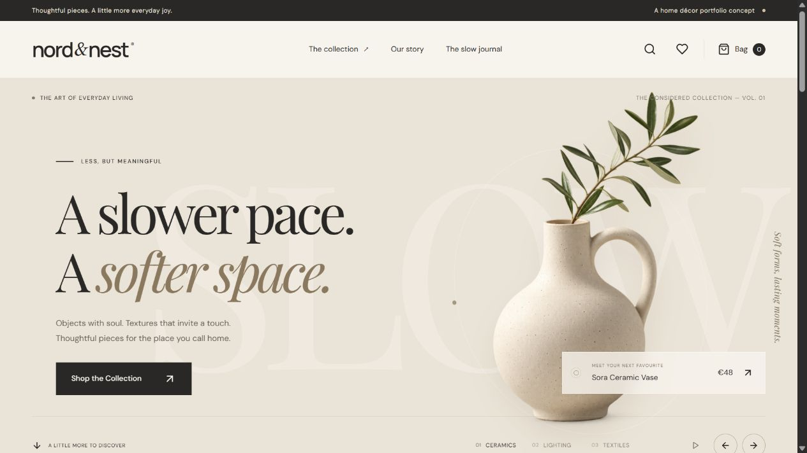
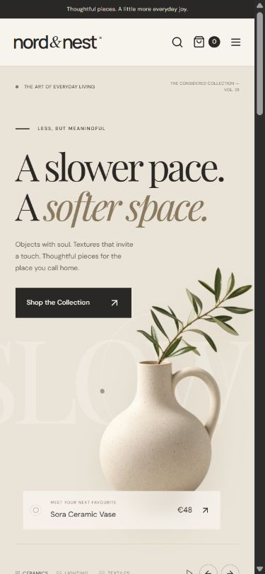

# Nord & Nest

A fictional Scandinavian home décor storefront built as an interactive developer portfolio project. The experience combines warm editorial styling, animated product presentations and a complete browser-based demo shopping flow.

**[View the live site](https://nord-and-nest.vercel.app)** · [Deployment notes](DEPLOYMENT.md) · [Verification record](QA.md) · [Asset credits and prompts](ASSETS.md)



## Features

- Three animated hero collections with floating product imagery, pointer parallax, manual navigation and playback controls.
- 16 fictional products across ceramics, lighting, textiles, candles and decorative objects.
- Product detail pages with presentation options, quantity selection and full-image/texture views.
- Search, category, price and availability filters, plus price and alphabetical sorting. Filter selections are reflected in the URL.
- A persistent shopping bag and wishlist, with validated browser storage, quantity limits and consistent subtotals.
- A demo checkout with labelled validation errors and an explicit completion screen. No payment or real order is processed.
- Responsive layouts, keyboard focus states, accessible dialogs and reduced-motion support.
- Empty, unavailable-product, missing-image and not-found states, along with brand story and contact pages.

## Technology

| Area | Implementation |
| --- | --- |
| Framework | Next.js 15 App Router with static export |
| UI | React 19, TypeScript, Tailwind CSS 4 and custom CSS |
| State | Zustand with validated `localStorage` persistence |
| Forms | React Hook Form and Zod |
| Icons | Lucide |
| Tests | Node.js test runner through `tsx` |
| Hosting | Vercel |

The storefront does not require a database, backend service, account or API key. Product imagery was generated for this project; provenance and final prompts are documented in [ASSETS.md](ASSETS.md).

## Local development

Use Node.js 20.9 or later and npm.

```sh
npm ci
npm run dev
```

Open the local URL printed by Next.js.

| Command | Purpose |
| --- | --- |
| `npm run dev` | Start the development server |
| `npm test` | Run cart, catalog and checkout validation tests |
| `npm run typecheck` | Check TypeScript types |
| `npm run build` | Generate the production export in `out/` |
| `npm run preview` | Serve the export at `http://127.0.0.1:4187` |

Build the project before running the static preview. No demo credentials are needed.

## Pages

| Route | Purpose |
| --- | --- |
| `/` | Animated collection introduction and featured pieces |
| `/shop/` | Searchable, filterable product catalog |
| `/shop/[slug]/` | Individual product details |
| `/wishlist/` | Saved pieces |
| `/cart/` | Shopping bag and totals |
| `/checkout/` | Validated demo checkout |
| `/about/` | Brand concept and editorial journal |
| `/contact/` | Sample contact information and demo FAQs |

## Portfolio case study

The goal was to turn a small e-commerce roadmap into a coherent, interactive storefront. The visual identity uses ivory, charcoal, sand and clay, with large serif typography and tactile product imagery. Motion is concentrated around product discovery through the hero, hover effects and scroll reveals.

Static product routes keep deployment straightforward. Zustand centralizes shopping state, while the persistence boundary checks product IDs, presentation options and quantities before accepting saved data. Display prices are derived from the product catalog. A shared catalog image is framed in CSS to keep the product photography consistent.



## Verification

The production build, TypeScript check and four automated test cases have passed. Browser checks covered filters, sorting, product options, wishlist persistence, bag operations, invalid and valid demo checkout, keyboard dismissal and responsive layouts. Public Vercel routes, images, metadata and cart persistence were also checked. See [QA.md](QA.md) for the recorded scope and limits of verification.

## Demo boundaries

Products, prices, brand claims and contact details are fictional. Prices use sample EUR values, and demo delivery is €0. Cart and wishlist data stay in the current browser. Checkout details are validated locally and are neither submitted nor saved.

There are no customer accounts, payment processing, live inventory or order fulfillment. A commercial implementation would require trusted server-side pricing, inventory validation and a suitable payment integration. Product galleries show the original catalog image and a texture crop. Fonts load from Google Fonts with system fallbacks.

## Deployment

The public site is hosted at **https://nord-and-nest.vercel.app**. It was initially deployed through Vercel Drop. GitHub integration is pending; this documentation does not claim that automatic deployment is connected.

The original private Sites deployment is retained. Hosting configuration, deployment identifiers and update instructions are recorded in [DEPLOYMENT.md](DEPLOYMENT.md).
